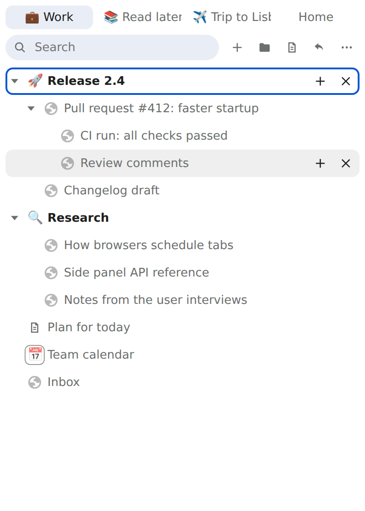

# Bookmark Tree

Your pages as trees, in Chrome's side panel.

A page you keep is a node in a tree. An open tab is only one way a node can
be at the moment: close the tab and the node stays, asleep, where you put it;
click it and the page opens again. So tabs and bookmarks are one thing, and
the tree is yours to arrange.

**Status:** early. It works and is tested in Chromium, but has had one user
so far. Read [what is not verified yet](#not-verified-yet) before trusting it
with a library you care about, and keep backups (Settings has a button).

## What it does

- **Trees of pages.** A link opened from a page becomes its child. Drag to
  rearrange, indent with Tab, fold branches, select several, undo.
- **Sleeping pages.** Put a branch to sleep to free its memory; the nodes
  stay. Open a whole branch again in one go.
- **Several trees**, laid out in a table on top; two trees side by side. One
  page can sit in several trees.
- **Groups and notes.** A group is a heading for the nodes under it. A note
  is a page of your own, written in Markdown, with task lists.
- **Pinned pages** remember the address they belong to and go back to it.
- **A plan of what to open next**, a strip at the top: drop pages on it,
  drag to reorder; a page you have been at leaves it.
- **A journal of where you were**: the last place is one click (or Alt+J)
  away, the ones before it a list at the bottom of the panel.
- **Search**, icons for nodes and trees, a trash that keeps deleted pages for
  30 days.
- **Bookmarks in and out:** import the browser's bookmarks or a bookmarks
  file of any browser; export a tree as such a file.
- **Backups:** the library is put aside every hour on this computer, and can
  be saved whole as a file.
- **Sync** between your computers with no setup, through the storage Chrome
  keeps in sync for your account (the freshest pages first, if the library
  outgrows it); and through a private GitHub repository of
  your own, with every sync kept as a version you can go back to.

The extension never moves or reorders the browser's own tabs. It listens to
what happens to them, and only ever opens, focuses or closes one.

## Install

There is no build step.

1. Download or clone this repository.
2. Open `chrome://extensions`, turn on *Developer mode*, press *Load
   unpacked* and choose the folder.
3. Press Alt+T, or the extension's button, to open the panel.

Needs Chrome 116 or newer.

## Sync

1. Create an empty private repository on GitHub.
2. Create a fine-grained access token for that repository with *Contents:
   Read and write*.
3. In the panel: "⋯" → Settings → enter `owner/repository` and the token.
4. Do the same on your other computers.

The token is kept as plain text in the extension's storage on your computer.

## Your data

Everything is kept on your computer, in the extension's storage. It leaves
only to places that are yours: the GitHub repository you name, and Chrome's
own synced storage of your Google account. There is no server of ours.

## Not verified yet

- Sync against the real GitHub (it is tested against a local stand-in).
- The quick exchange through Chrome's synced storage, on two real computers.
- Several browser windows; Chrome restoring a session by itself.
- Large libraries (thousands of nodes).

## Development

    npm install        # only for the tests in a browser
    npm test           # the model, the operations, merging: plain Node
    node test/browser/basics.mjs   # scenarios in a real Chromium, one file each

The code is plain ES modules. `src/model.js`, `ops.js`, `core.js` and
`merge.js` are pure and hold the rules; `src/worker.js` is the one owner of
the state; the panel and the settings page only show it and send commands.

`TASKS.md` and `UX.md` are the working notes, in Russian.

## License

[MIT](LICENSE). The bundled libraries keep their own:
[lit-html](src/vendor/lit-html/LICENSE),
[Tiptap, ProseMirror and others](src/vendor/tiptap/LICENSES.txt).
